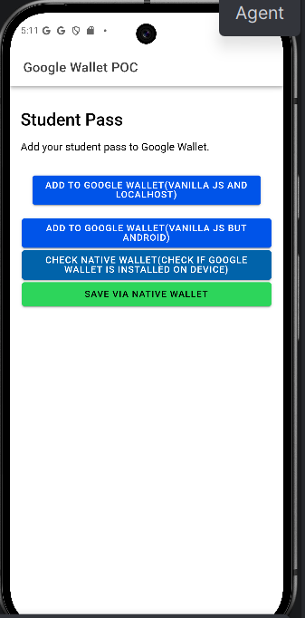
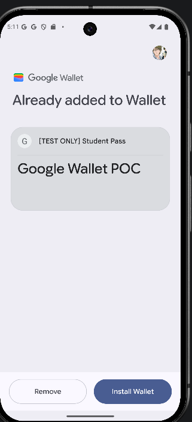

# Google Wallet POC

A small Ionic/Angular app and Express backend for issuing a Google Wallet student pass. The backend creates signed Wallet JWTs with a Google service account; the frontend opens the resulting Google Wallet save URL or uses the Capacitor native plugin.

## Screenshot

<!-- Add your screenshot at docs/images/google-wallet-poc.png, or update this path. -->



## Project Structure

- `backend/` - Express API, Google Wallet API client, and JWT signing.
- `frontend/google-wallet-ionic/` - Ionic/Angular app with Capacitor Android support.
- `frontend/google-wallet-ionic/android/` - Android project and native Wallet plugin integration.

## Wallet Flows

- **Web link:** The app requests `/wallet/add-link` and navigates to the returned `addToWalletUrl`.
- **Capacitor Browser:** Opens the same signed save URL in the system browser.
- **Native Wallet:** Checks Wallet availability or saves the returned JWT through the native Capacitor plugin.

## Requirements

- Node.js and npm.
- A Google Wallet issuer account with the Google Wallet API enabled.
- A Generic pass class with ID `<ISSUER_ID>.genclass`.
- A Google service account authorized for the issuer, with its JSON key stored locally.
- Android Studio and an Android emulator/device for native testing.

The backend expects the class to exist. `/wallet/object` returns the student object if it exists, or creates it using that class.

## Local Setup

1. Configure `backend/.env`:

   ```env
   PORT=3000
   ISSUER_ID=YOUR_ISSUER_ID
   GOOGLE_APPLICATION_CREDENTIALS=./google-wallet-service-account.json
   ```

2. Put the downloaded service-account JSON at `backend/google-wallet-service-account.json`. Keep this key private and never commit it.
3. Start the backend from the `backend/` directory:

   ```sh
   npm install
   node server.js
   ```

4. In another terminal, start the frontend:

   ```sh
   cd frontend/google-wallet-ionic
   npm install
   npm start
   ```

5. Open [http://localhost:4200/home](http://localhost:4200/home).

For the Android emulator, the frontend uses `http://10.0.2.2:3000` to reach the host machine's backend. The web frontend uses `http://localhost:3000`. When testing on a physical device or a deployed site, update the API host and the JWT `origins` in `backend/server.js` to match the actual environment.

To run on Android after installing dependencies, use `npx cap sync android` followed by `npx cap run android` from the frontend directory.

## Backend Routes

| Route | Purpose |
| --- | --- |
| `GET /health` | Backend health check. |
| `GET /wallet/class` | Reads the configured Generic class. |
| `GET /wallet/object` | Reads or creates the student Generic object. |
| `GET /wallet/add-link` | Returns object/class IDs, a signed JWT, and the Google Wallet save URL. |

## Security Notes

The root `.gitignore` excludes `.env` files and `google-wallet-service-account.json`. Keep service-account keys, environment values, and generated JWTs out of commits and public logs. Restrict CORS and configure production origins before deployment. The current local Git index does not track the backend `.env` or service-account JSON; this does not establish whether a credential was ever pushed in earlier history or to a remote. If a key was exposed, revoke it and create a replacement.

## Useful Commands

- Backend: `node server.js`
- Frontend dev server: `npm start`
- Frontend production build: `npm run build`
- Frontend tests: `npm test`
- Frontend lint: `npm run lint`
